<p align="center">
  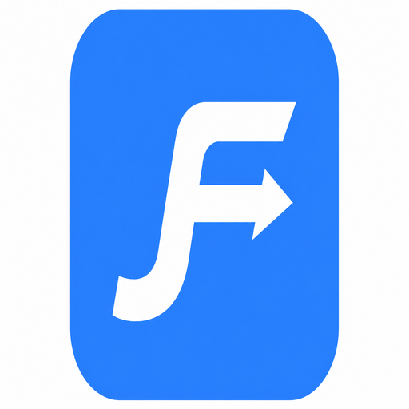
</p>

# JobFlowTracker

Personal **job search**, **recruiter pipeline**, and **task management** tracker with AI assistance, kanban board, multi-language (EN/עב/FR), private Google Drive sync, an Android app, and offline backup.

**Live app:** https://job-flow-tracker-ten.vercel.app

**Contributing:** [CONTRIBUTING.md](CONTRIBUTING.md) · **Issues:** [github.com/joka-7/JobFlowTracker/issues](https://github.com/joka-7/JobFlowTracker/issues) · **License:** [MIT](LICENSE)

---

## Three modes — switch anytime

| Mode | For | Tracks |
|------|-----|--------|
| **Job seeker** | People looking for work | Companies, applications, interviews |
| **Recruiter** | Hiring managers / recruiters | Candidates through hiring stages |
| **Task manager** | Anyone managing multi-step work | Tasks with ordered steps and per-step status |

Choose your starting mode on first visit. Switch freely at any time using the **mode switcher** in the app header — each mode keeps its own data independently.

See [docs/LLD.md](docs/LLD.md#2-data-schema) for the full recruiter status list and data schema.

---

## Screenshots

### Mode selection

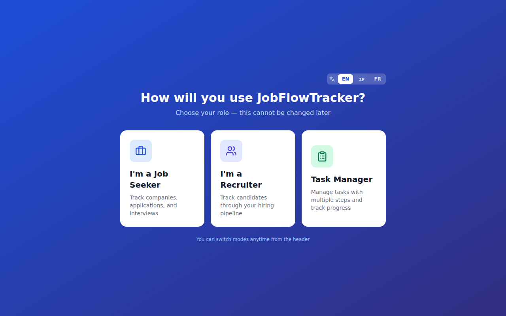

### Mode switcher (in header)

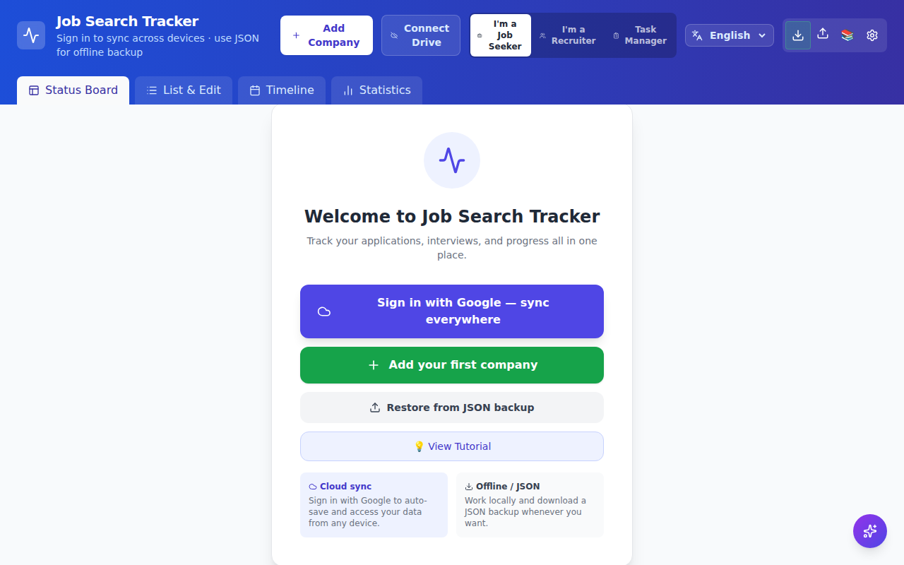

### Job Seeker mode

| Kanban board | List & company detail |
|---|---|
| 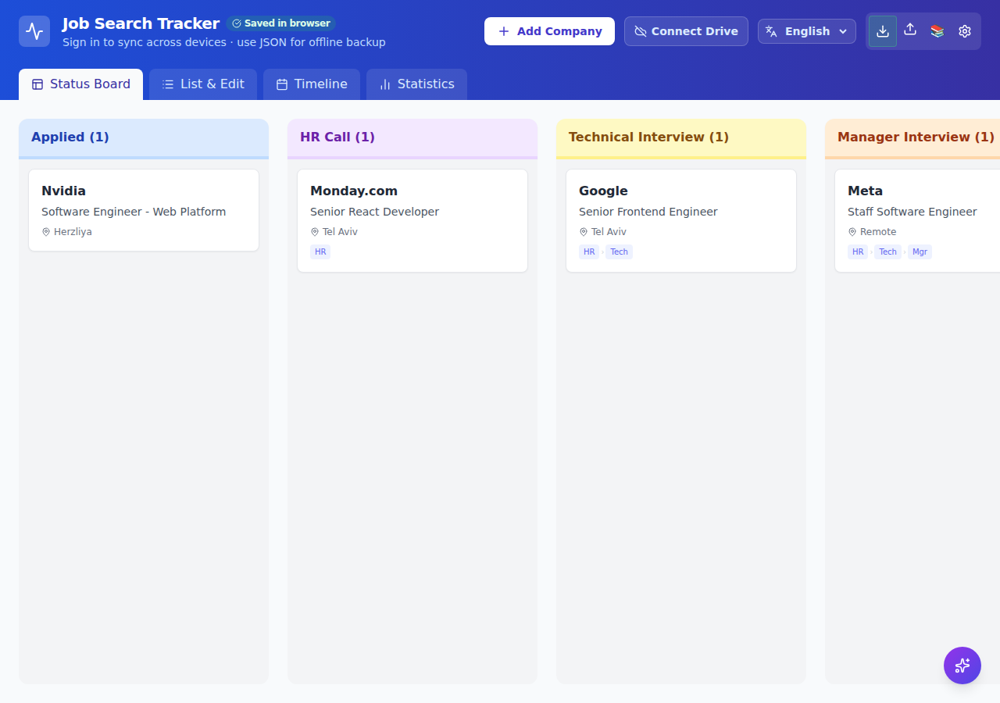 | 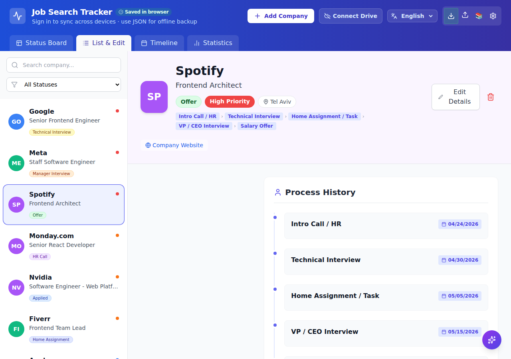 |

| AI Assistant | Statistics |
|---|---|
| 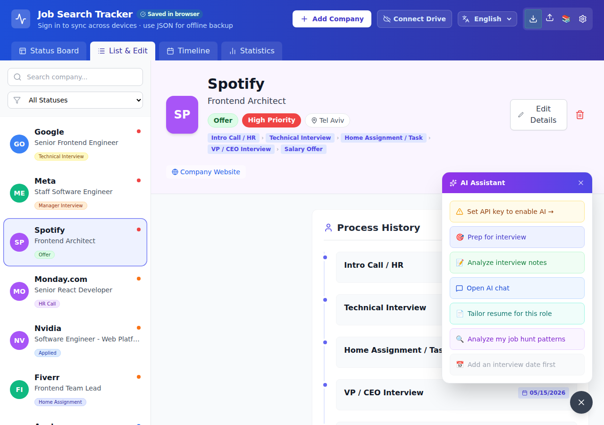 | 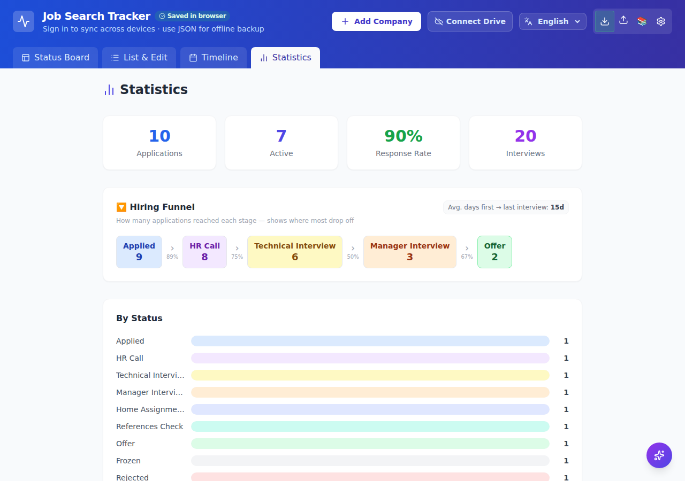 |

### Recruiter mode

| Kanban board | Candidate detail |
|---|---|
| 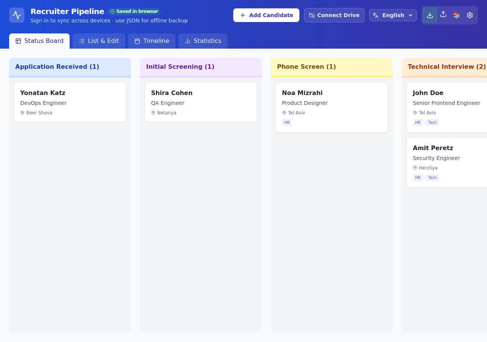 | 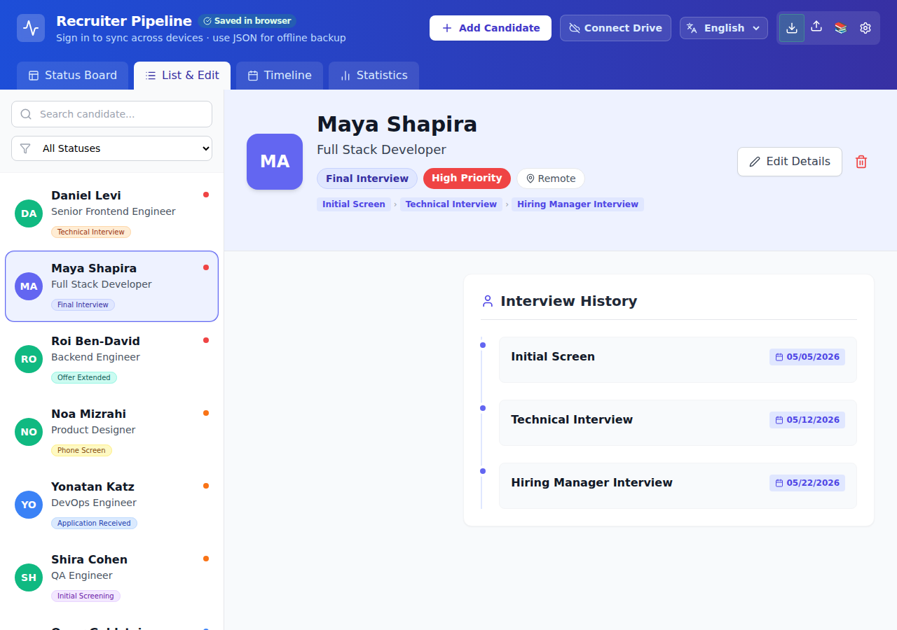 |

### Task Manager mode

| Kanban board | List & step detail | Statistics |
|---|---|---|
| 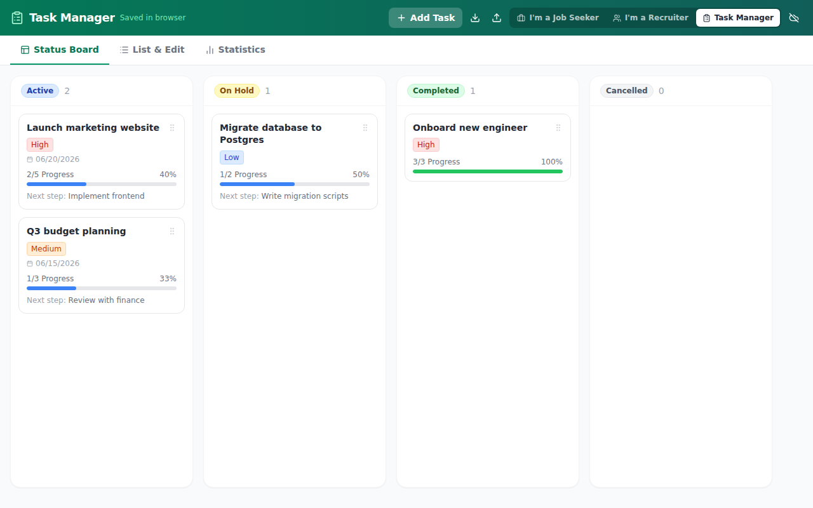 | 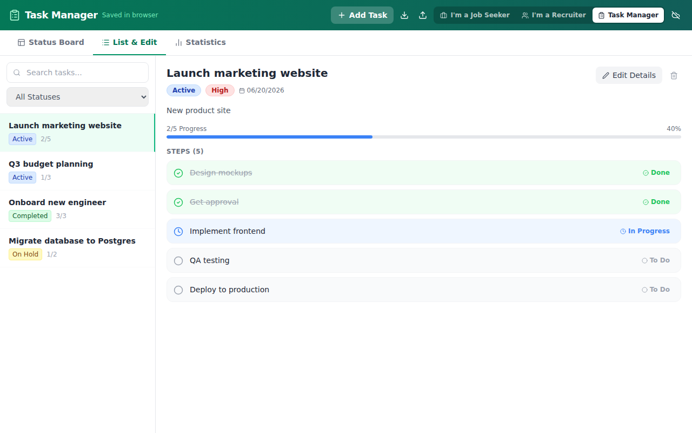 | 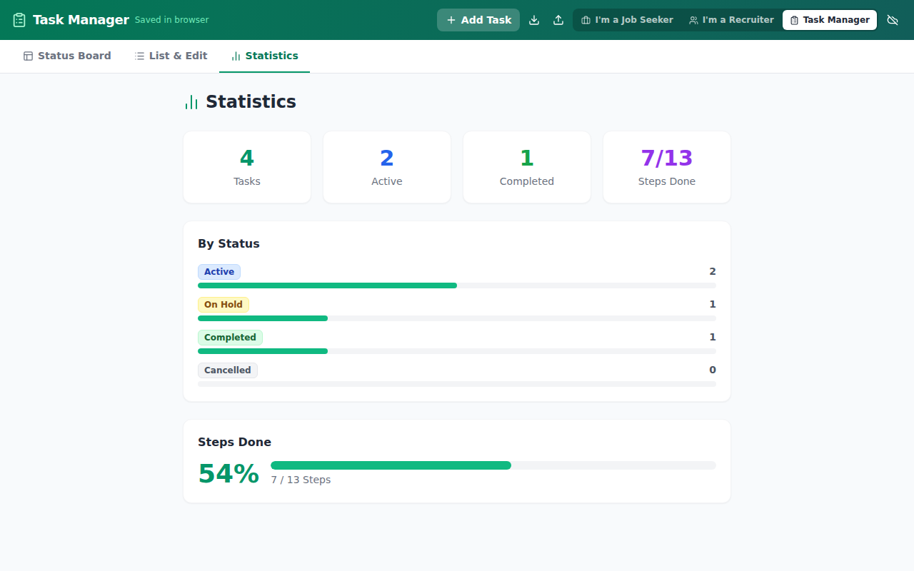 |

### Calendar view (all modes)

| Monthly grid | Day detail panel |
|---|---|
| 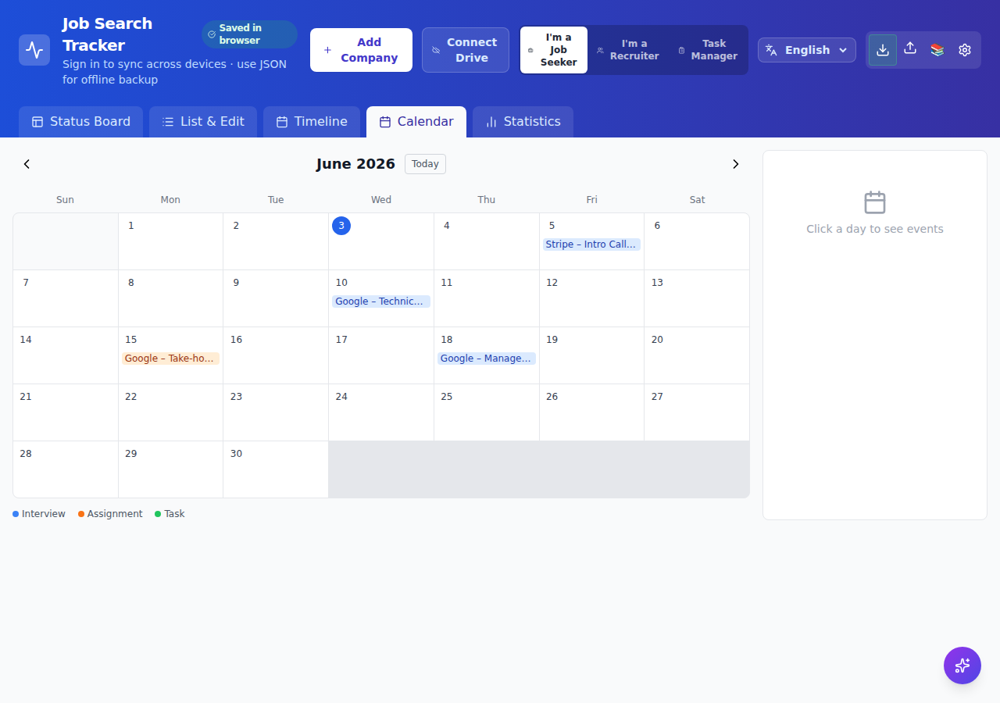 | 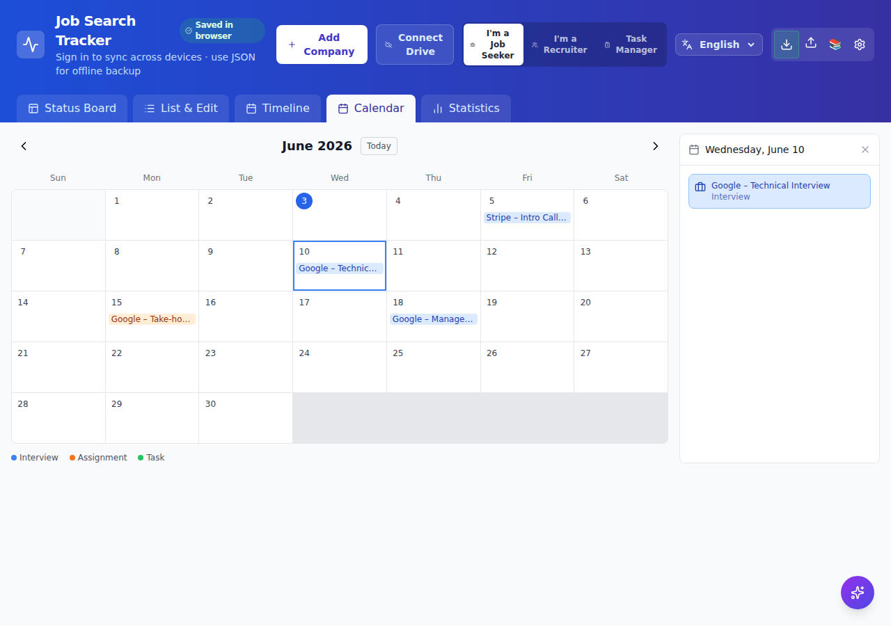 |

---

## Features

### Views & Navigation
- **Kanban board** — drag-and-drop cards across status columns
- **List & edit view** — detailed profiles with history and notes
- **Calendar** — monthly grid showing interviews, deadlines, and task due dates; click any day to see its events
- **Timeline** — chronological activity log of all interviews and submissions (job seeker & recruiter)
- **Stats** — counts, response rate, upcoming events, hiring funnel

### Task Manager
- Tasks contain **ordered steps**, each with its own status: To Do → In Progress → Done → Blocked
- Click any step status icon to cycle it without entering full edit mode
- Progress bar on every card: `done / total steps` and percentage
- "Next step" preview on board cards
- **Priority** — a computed 0–100 score from urgency × impact × effort, with a **Priority** view that ranks tasks into Do Now, Quick Wins (BISE — big impact, small effort), Big Projects, Fill-ins, and Later
- **Type** — a fixed action-verb taxonomy (fix/buy/order/arrange/throw/call/email/clean/research/other) with its own **By Type** view and board/list filter
- **Effort** — a quantized minutes-to-years ladder (instead of free-typed duration) that feeds the priority score and is user-tunable (small/medium/large cut-points)
- **Routines** — daily/weekly/monthly recurring tasks that reset to their next due date (instead of staying completed) when marked done, from the form or by dragging to the Completed column
- **Reminders** — browser-notification due-time alerts with snooze (15 min / 1 hour / 4 hours)
- Board, List+Detail, Priority, By Type, Timeline, Calendar, and Stats views

### AI Assistant (5 providers, all modes)
Supports Google Gemini, Groq (free tier), Ollama (free/local), Anthropic Claude, and OpenAI.

**Job Seeker — 🔍 Find Jobs button:**
- Suggests job boards, LinkedIn search strategies, and networking tactics based on your applied roles
- Helps craft outreach and referral messages

**Recruiter — 👥 Find Candidates button:**
- Generates LinkedIn Boolean search strings and sourcing strategies tailored to open positions
- Suggests sourcing channels (GitHub, Stack Overflow, Wellfound) and InMail templates

**Task Manager — 🎯 Goals & Tasks button:**
- Helps define SMART goals and break them into actionable steps
- Finds open-source projects and volunteering opportunities matching your interests

**Job Seeker — AI Assistant panel (per company):**
- **Interview prep** — 3 focused preparation tips generated before each interview
- **Rejection analysis** — constructive improvement suggestions after a rejection
- **Pattern analysis** — identifies trends and themes across all your applications
- **Interview debrief** — structured analysis of post-interview notes
- **Smart scheduling** — day-by-day prep plan counting down to your interview date
- **Resume tailoring** — suggests which experiences and skills to highlight for each company
- **Multi-turn AI chat** — open-ended conversation with full company context loaded

### Data & Sync
- **Private by design** — data lives on your device and, if you connect it, in a hidden app-only folder of **your own** Google Drive. There is no JobFlowTracker server or database, so the developer can't read anyone's data
- **Google Drive sync** — each device writes its own file; the newest version of each record wins, and deletes sync too
- **Disconnect / delete** — disconnecting removes this device's copy; **Settings → Your data** deletes everything synced to Drive and revokes access
- **Offline backup** — export and import your full dataset as JSON at any time
- **CSV export** — download your data as a spreadsheet-ready `.csv` alongside the JSON backup (export only — CSV isn't used for restore)
- Each mode's data is stored independently: switching modes never loses data from other modes

### Interview Template Library
80+ curated questions across 6 categories: HR, Technical, Behavioral, Manager, Culture, and Questions to Ask.

### Onboarding & UX
- **Mode selection** — first-time users choose a starting mode; switch anytime from the header
- **Onboarding wizard** — 5-step guided tour on first visit (job seeker only)
- **3 languages** — English, Hebrew (RTL), French; persists across sessions
- **Keyboard shortcuts** — `N` to add a company/candidate/task, `Esc` to close
- **Search & multi-status filter** — free-text search plus toggleable status pills narrow the list view (job seeker / recruiter)
- **Bulk actions** — select multiple companies/candidates with checkboxes to bulk change status, export, or delete (with confirmation) via the bulk actions bar

---

## How to Use

### 1. First Launch

**New users:** A full-screen mode picker asks which mode to start with. You can switch to any other mode at any time using the switcher in the app header.

**Returning users with existing data:** If you already have a JSON backup in the browser, the app auto-selects **Job Seeker** and skips the picker.

**Job seeker only:** A 5-step onboarding wizard may appear after mode selection. Click through or dismiss with **X**.

To sync across devices, click **Connect Drive** in the header and allow access to the app's own Drive folder. Without it the app works fully offline.

### 2. Job seeker — Adding Your First Company

Click **+ Add Company** (or press `N`) to open the company form. Fill in:

- **Company name** (required)
- **Role** — the position you applied for
- **Status** — start with *Applied*
- **Priority** — High / Medium / Low
- **Location, Website, LinkedIn** — optional
- **General notes** — recruiter name, referral source, compensation details

Click **Save**. The company appears on the Kanban board and in the list.

### 2b. Recruiter — Adding Your First Candidate

Click **Add Candidate** (or press `N`). Fill in candidate name, position, hiring stage, and optional recruiter-specific fields (LinkedIn, current role, expected salary, source).

Data syncs to `users/{uid}/candidates/` when signed in. Use the **👥 Find Candidates** button in the header to get AI-powered sourcing strategies for your open positions.

### 2c. Task Manager — Adding Your First Task

Click **Add Task** (or press `N`). Fill in:

- **Task name** (required)
- **Description** — goal or context
- **Status** — Active / On Hold / Completed / Cancelled
- **Priority** and optional **Due Date**
- **Steps** — add as many steps as needed; each step gets its own status

After saving, click any step's status icon in the detail panel to cycle it:
`To Do → In Progress → Done → Blocked → To Do`

### 3. Tracking the Process

**Update status** — on the Kanban board, drag the card to the new column. In the list view, open the item and change the Status dropdown.

**Add an interview** — open the company, scroll to the Interviews section, click **+ Add Interview**.

**Log a rejection** — set status to *Rejected*. A section appears to record rejection details for AI analysis.

### 4. Switching Modes

The **mode switcher** appears in every app header as three small icon buttons (Briefcase / Users / ClipboardList). Click any icon to switch instantly. Each mode's data is stored separately and is never affected by switching.

### 5. Setting Up AI

Click the **gear icon (⚙️)** in the header to open AI Settings. Choose a provider:

| Provider | Cost | Notes |
|---|---|---|
| Groq | Free tier | Fast; get key at console.groq.com/keys |
| Ollama | Free (local) | Runs on your machine; needs CORS enabled |
| Google Gemini | Free tier / paid | Get key at aistudio.google.com/app/apikey |
| Anthropic Claude | Paid | Get key at console.anthropic.com/settings/keys |
| OpenAI | Paid | Get key at platform.openai.com/api-keys |

**Recommended for getting started:** Groq — create a free account, generate an API key, paste it in, and click **Save**.

### 6. Using the AI Assistant Panel

Once a provider is configured, open any company and click the **AI Assistant** button. The panel includes: Interview Prep, Smart Schedule, Rejection Analysis, Interview Debrief, Pattern Analysis, Resume Tailoring, and AI Chat.

### 7. Backup and Restore

**Export (JSON):** Click the download icon in the header. Your dataset downloads as `.json`. This is the format to use for backups — it's the only one you can re-import.

**Export (CSV):** Click the spreadsheet icon next to it (or **Download as CSV** in the mobile menu) to download a `.csv` for Excel/Google Sheets/Numbers. CSV is export-only — there's no CSV import.

**Import:** Click the upload icon and select a previously exported `.json` file.

### 8. Keyboard Shortcuts

| Shortcut | Action |
|---|---|
| `N` | Open "Add" form |
| `Esc` | Close modal / cancel form |

---

## Tech Stack

| Layer | Technology |
|---|---|
| Frontend | React 19, Vite |
| Styling | Tailwind CSS |
| Sync | Google Drive `appDataFolder` (each user's own Drive) via Google Identity Services |
| Android | Capacitor (`android/`), Google sign-in via `@capgo/capacitor-social-login` |
| i18n | react-i18next (EN / עב / FR) |
| AI providers | `modeldispatcher-browser-agent`: Anthropic, Groq, Gemini, OpenAI, Ollama (user's own key) |
| Icons | lucide-react |
| Hosting | Vercel |

---

## Project Structure

<!-- BEGIN GENERATED TREE (depth=1 entries=all) -->
```text
JobFlowTracker/
├── .github/
├── android/
├── docs/
├── e2e/             # Playwright end-to-end tests
├── public/
├── scripts/         # Bundle-size check + icon generation scripts
├── src/             # App source — mode gate, per-mode UIs, shared services
├── .ai              # Ogen-ai submodule — the shared source of rules, skills and the ai-sync…
├── .env.example
├── .gitignore
├── .gitleaks.toml
├── .gitmodules
├── .markdownlint.json
├── .npmauditignore
├── .trivyignore
├── AGENTS.md        # The compiled coding rules every AI assistant reads — generated, do not…
├── CHANGELOG.md     # Changelog
├── CLAUDE.md        # Claude Code's copy of AGENTS.md (generated)
├── CONTRIBUTING.md  # Contributing to JobFlowTracker
├── GEMINI.md        # Gemini CLI's copy of AGENTS.md (generated)
├── LICENSE
├── README.md        # JobFlowTracker
├── SECURITY.md      # Security Policy
├── ai-config.toml   # Which rule fragments and target tools ai-sync compiles for this repo
├── capacitor.config.json
├── eslint.config.js
├── firestore.rules
├── index.html
├── package-lock.json
├── package.json
├── playwright.config.js
├── postcss.config.js
├── tailwind.config.js
├── vercel.json
└── vite.config.js
```
<!-- END GENERATED TREE -->

Full annotated tree, every file: [`docs/STRUCTURE.md`](docs/STRUCTURE.md). Generated —
regenerate after adding/renaming a file with:
```bash
python .ai/skills/repo_tree/gen_tree.py --project . --output docs/STRUCTURE.md
python .ai/skills/repo_tree/gen_tree.py --project . --output README.md --max-depth 1
```

---

## Run Locally

```bash
git clone https://github.com/joka-7/JobFlowTracker.git
cd JobFlowTracker
npm install
npm run dev
```

Open http://localhost:5173

---

## AI Setup

Click the **⚙️ gear icon** in the app header → choose your provider → paste your API key → **Save**.

| Provider | Free? | Where to get a key |
|---|---|---|
| Groq | Yes (free tier) | https://console.groq.com/keys |
| Ollama | Yes (runs locally) | https://ollama.ai — no key needed |
| Google Gemini | Free tier available | https://aistudio.google.com/app/apikey |
| Anthropic Claude | Paid | https://console.anthropic.com/settings/keys |
| OpenAI | Paid | https://platform.openai.com/api-keys |

**Ollama note:** Ollama must be started with CORS enabled:
```bash
OLLAMA_ORIGINS=* ollama serve
```

---

## Google Drive & your data

**Using the [live app](https://job-flow-tracker-ten.vercel.app)?** Nothing to set up.

1. Click **Connect Drive** in the header and approve access. The app asks only for `drive.appdata`: a hidden folder that only this app can see, not the rest of your Drive.
2. Each device writes its own `jobflowtracker-<device>.json` there; every device reads them all and keeps the newest version of each record.
3. **Disconnect** (click your name in the header) removes this device's copy. **Settings → Your data → Delete synced data** removes every file from your Drive and revokes the app's access.

---

## Android app

Download **JobFlowTracker.apk** from the [latest release](https://github.com/joka-7/JobFlowTracker/releases/latest/download/JobFlowTracker.apk) on the phone and open it (allow installing from this source when asked). Every push to `main` builds a new signed APK (`.github/workflows/android.yml`) that installs over the previous one.

---

## Backend setup (maintainers & self-hosters only)

Skip this section if you are only using the hosted app.

1. In a Google Cloud project, enable the **Google Drive API** and add the `https://www.googleapis.com/auth/drive.appdata` scope to the OAuth consent screen (non-sensitive: no verification needed).
2. Create an OAuth client of type **Web application**; add your site's origin under **Authorized JavaScript origins**.
3. Set `VITE_GOOGLE_CLIENT_ID` to that client ID (see [`.env.example`](.env.example)) locally and in Vercel. Without it the app runs offline-only and hides **Connect Drive**.
4. Android builds also need an **Android** OAuth client (package `io.github.joka7.jobflowtracker` + the signing key's SHA-1), the `VITE_GOOGLE_CLIENT_ID` repository variable, and the `ANDROID_KEYSTORE_B64`, `ANDROID_KEYSTORE_B64_2` and `ANDROID_KEY_PASSWORD` secrets — see [docs/LLD.md](docs/LLD.md#android-app).

[`firestore.rules`](firestore.rules) denies all access: Firestore is no longer used.

---

## Deploy to Vercel

1. Push to GitHub
2. Import the repo at https://vercel.com
3. Framework preset: **Vite**
4. Set the `VITE_GOOGLE_CLIENT_ID` environment variable (optional — enables Drive sync)
5. Deploy

---

## Run Tests

```bash
npm test          # Vitest — unit + integration
npm run test:e2e  # Playwright — browser e2e (port 5199)
npm run test:all  # Both suites
```

---

## Secret scanning (Gitleaks)

CI runs [Gitleaks](https://github.com/gitleaks/gitleaks) on every push and PR.

```bash
# Install (Linux x64)
mkdir -p ~/.local/bin
GITLEAKS_VERSION=v8.30.1
curl -sL "https://github.com/gitleaks/gitleaks/releases/download/${GITLEAKS_VERSION}/gitleaks_${GITLEAKS_VERSION#v}_linux_x64.tar.gz" \
  | tar -xz -C ~/.local/bin gitleaks
chmod +x ~/.local/bin/gitleaks

# Run scan
gitleaks detect --source .
```

The repo includes `.gitleaks.toml`, which allowlists the old `src/firebase.js` (a public project config, still in git history).

---

## Data Schema

**Job seeker path:** `users/{uid}/companies/{companyId}`  
**Recruiter path:** `users/{uid}/candidates/{candidateId}`  
**Task manager path:** `users/{uid}/tasks/{taskId}`

**localStorage keys:** `jobTrackerAppV2Data_jobseeker`, `jobTrackerAppV2Data_recruiter`, `jobTrackerAppV2Data_tasks`

**Task document:**

```json
{
  "id": "1717600000000",
  "name": "Launch product website",
  "description": "Goal or context",
  "status": "active",
  "priority": "high",
  "impact": "high",
  "urgency": "week",
  "type": "other",
  "effort": { "value": 2, "unit": "day" },
  "dueDate": "2026-06-20",
  "dueTime": "09:00",
  "routine": { "enabled": false, "frequency": "weekly", "interval": 1, "weekdays": [1, 2, 3, 4, 5], "endDate": "" },
  "reminder": { "enabled": false, "minutesBefore": 60, "snoozedUntil": "" },
  "lastReminderKey": "",
  "notes": "Free-form notes",
  "steps": [
    { "id": "s1", "title": "Design mockups", "status": "done", "notes": "", "dueDate": "" },
    { "id": "s2", "title": "Implement frontend", "status": "in_progress", "notes": "", "dueDate": "" },
    { "id": "s3", "title": "Deploy to production", "status": "todo", "notes": "", "dueDate": "" }
  ]
}
```

**Task status values:** `active`, `on_hold`, `completed`, `cancelled`  
**Step status values:** `todo`, `in_progress`, `done`, `blocked`  
**Task type values:** `fix`, `buy`, `order`, `arrange`, `throw`, `call`, `email`, `clean`, `research`, `other`, or `''` (untyped)  
**Impact values:** `high`, `medium`, `low` — **Urgency values:** `now`, `today`, `week`, `month`, `someday`, or `''` (`overdue` is derived, never stored)

**Company / candidate document** — see [docs/LLD.md](docs/LLD.md#2-data-schema) for the full field list.

---

## Contributing

Contributions are welcome. Please read [CONTRIBUTING.md](CONTRIBUTING.md) for setup, tests, and pull request guidelines.

- **Bug reports & features:** [Open an issue](https://github.com/joka-7/JobFlowTracker/issues/new/choose)
- **Pull requests:** Fork → branch → tests → PR to `main`
- **Security:** [SECURITY.md](SECURITY.md)
