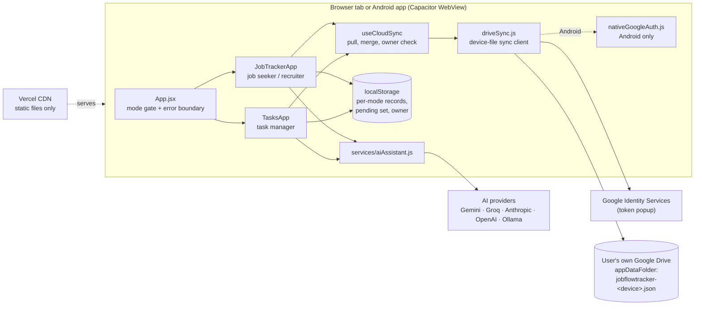
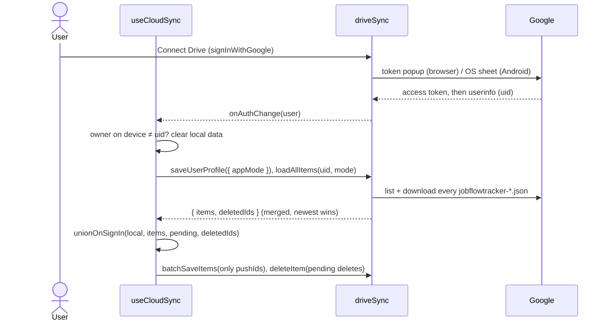

# JobFlowTracker — High Level Design

## 1. Overview

JobFlowTracker is a single-page application (SPA) for tracking a job search, a recruiter hiring pipeline, or multi-step task management. Users choose a starting mode on first visit and can switch freely at any time using the header mode switcher. All modes use a kanban-based UI with mode-specific statuses and form fields. Each mode's data is stored in its own scoped localStorage key and its own collection of the Drive sync file — switching modes never affects other modes' data. The same build ships as a website (Vercel) and as an Android app (Capacitor).

**Key design principles:**

- **No custom backend, private by design.** All business logic runs in the browser. Optional sync goes straight from the browser to the user's **own** Google Drive (`appDataFolder`, `drive.appdata` scope), so the operator holds no copy of anyone's data. Vercel provides static hosting only.
- **Three modes, freely switchable.** `App.jsx` gates on `localStorage.appMode`. `ModeDropdown` in every header lets users move between modes at runtime. Each mode's data persists independently.
- **Client-side AI (all three modes, scope varies).** AI requests run from the browser with the user's API key. Every mode has a mode-specific AI action (Find Jobs / Find Candidates / Goals & Tasks, via `ChatModal`); the full floating AI Assistant panel — interview prep, rejection analysis, pattern analysis, debrief, smart scheduling, resume tailoring, multi-turn chat — is job seeker only (`AIAssistant.jsx`, hidden when `isRecruiter` and never rendered by `TasksApp.jsx`).
- **User-isolated data.** Each user's data is in their own Drive, readable only by this OAuth client. Local data is tagged with its owner's account and never merged into a different account's Drive (`readDataOwner`).
- **Offline-first local cache.** Data is written to mode-scoped localStorage keys on every mutation.
- **Granular writes.** Each mutation calls `updateItem(uid, mode, item)` for the affected record only; `driveSync` batches them into one upload of this device's file (1.5 s debounce).

---

## 2. Architecture Diagram



---

## 3. Components Table

| File | Type | Responsibility |
|---|---|---|
| `src/App.jsx` | Root | Mode gate: `ModeSelection`, `JobTrackerApp`, or `TasksApp`; tracks `autoOnboarding` flag |
| `src/statuses.js` | Config | `STATUSES_JOBSEEKER`, `STATUSES_RECRUITER`, `STATUSES_TASKS`, `STEP_STATUSES`, storage keys, `getCollectionName`, `resolveInitialAppMode` |
| `src/components/ModeSelection.jsx` | Full-screen | First-launch 3-mode picker (job seeker / recruiter / task manager) |
| `src/components/ModeDropdown.jsx` | Header widget | Dropdown button (icon buttons collapse to a single control when only one mode is enabled); updates `localStorage.appMode` and calls `onModeChange` |
| `src/JobTrackerApp.jsx` | Main component | Mode-aware UI for job seeker and recruiter; all tabs, Drive sync wiring |
| `src/TasksApp.jsx` | Main component | Task manager UI: board, list+step-detail, Priority (ranked by a computed urgency×impact×effort score), By Type, timeline, calendar, stats; step status cycling; routine advancement and due-time reminder polling |
| `src/components/AppErrorBoundary.jsx` | Error boundary | Wraps whichever app the mode gate renders (`App.jsx`); offers a localStorage JSON backup of that mode's data (`buildCrashBackup`) before reload |
| `src/driveSync.js` | Module | Google Drive `appDataFolder` sync: one file per device, newest entry wins per record, delete tombstones, clock-skew guard, Web Locks across tabs, retries; `deleteAllSyncedData`. Same API the Firestore module had, except `loadAllItems` returns `{ items, deletedIds }` |
| `src/nativeGoogleAuth.js` | Module | Android only: Drive access token from the OS via `@capgo/capacitor-social-login`, renewed silently |
| `src/hooks/useTaskReminders.js` | Hook | Tracks notification permission in state and polls for due task reminders every 30 s once granted |
| `src/hooks/useCloudSync.js` | Hook | One collection's sync lifecycle: `authResolved`, connect/refocus/`syncNow` pulls (focus pulls at most every 30 s, `utils/focusPull.js`), discards another account's local data, `signOutAndClear` / `deleteSyncedDataAndClear` |
| `src/utils/cloudSync.js` | Module | `unionOnSignIn` — reconciles a cloud pull against local state using the pending set |
| `src/utils/pendingSync.js` | Module | Which record ids changed locally without a confirmed cloud write, per collection |
| `src/components/Onboarding.jsx` | Modal | 5-step wizard (job seeker only, skipped when switching from another mode) |
| `src/services/aiAssistant.js` | Module | Thin wrapper over the shared `modeldispatcher-browser-agent` package (also used by KanDOne/HighFive/StepByLearn) — provider configuration, `initAI`, `isAIReady`, rate limiting, and this app's job-search prompts; streaming/parsing itself lives in the shared package |
| `src/components/AIAssistant.jsx` | Floating panel (job seeker only) | Sparkles button, menu screen, debrief; launches ChatModal and ResumeReview |
| `src/components/APIKeySettings.jsx` | Modal | Provider selector, API key / Ollama URL input, saves to localStorage |
| `src/components/ChatModal.jsx` | Modal | Multi-turn AI chat with streaming, company context, save-to-notes |
| `src/components/RejectionAnalysis.jsx` | Modal | Rejection AI analysis for a specific company, streaming result |
| `src/components/ResumeReview.jsx` | Modal | Resume paste, calls `getResumeAdvice`, streaming result |
| `src/components/TemplateLibrary.jsx` | Modal | 80+ interview questions, 6 categories, full-text search |
| `src/components/CalendarView.jsx` | View | Monthly calendar grid; receives `events[]`, shows color-coded chips per day, day-detail side panel, RTL-aware, i18n date formatting |
| `src/components/SearchFilter.jsx` | List sub-component | Search input + toggleable multi-status filter pills; reports changes via `onSearch` / `onFilterChange` callbacks |
| `src/components/BulkActionsBar.jsx` | List sub-component | Sticky bar shown when ≥1 item is checkbox-selected; bulk status update, export, delete (with its own confirm modal), and clear-selection actions |
| `src/components/Tooltip.jsx` | Utility | Hover tooltip using Tailwind group/group-hover classes |
| `src/data/interviewTemplates.js` | Data | `TEMPLATES` with 6 category keys |
| `src/locales/en.json` | i18n | English strings (includes `tasks.*` namespace) |
| `src/locales/he.json` | i18n | Hebrew strings (RTL) |
| `src/locales/fr.json` | i18n | French strings |
| `src/i18n.js` | Config | react-i18next initialization, language detection from localStorage |
| `src/main.jsx` | Entry | React root mount, i18n import |

---

## 4. Data Flow

### 4.1 Connect Drive Flow



#### Reconciling a pull against local state

Cloud is not authoritative for every id, because a local write can fail — or
never be attempted, because the session had not resolved yet. `utils/pendingSync.js`
records which record ids changed locally without a confirmed cloud write
(`driveSync.js` clears an id once its write lands), and `utils/cloudSync.js`
consults that set:

| Case | Winner |
| --- | --- |
| Id only in local state | Local, pushed to cloud |
| Shared id, pending local edit | Local, pushed to cloud |
| Shared id, no pending local change | Cloud |
| Id only in cloud, pending local delete | Dropped, delete replayed to cloud |
| Id only in local state, deleted on another device | Dropped (unless edited here since) |

Only the ids the cloud lacks or holds stale (`pushIds`) are uploaded: every
Drive write is stamped newest, so re-sending an unchanged record would beat an
edit made on another device in the meantime.

The third row is what keeps a stale device from resurrecting old data; the
second is what stops a pull from discarding work typed before a returning
session resolved (`useCloudSync`'s `authResolved`).

### 4.2 Mode Selection / Switching Flow

```
First visit (no appMode in localStorage)
  → ModeSelection screen (3 options)
  → user picks jobseeker | recruiter | tasks
  → localStorage.appMode = choice
  → App renders JobTrackerApp or TasksApp
  → jobseeker + autoOnboarding=true: may show Onboarding wizard
  → recruiter / tasks: skip onboarding

Switching via ModeDropdown (any time)
  → localStorage.appMode = newMode
  → App.setMode(newMode) → re-renders appropriate component
  → autoOnboarding=false → onboarding never shown when switching
  → each mode independently loads its own localStorage cache
```

### 4.3 Data Mutation Flow

Every mutation follows the same pattern: update React state → write localStorage → Drive write in background (batched per device file).

```
User action (add / edit / drag-drop / step status toggle)
  → setState(newState)
  → useEffect [state] fires
      → localStorage.setItem('jobTrackerAppV2Data_{mode}', JSON.stringify(data))
      → recordLocalChanges(mode, diff vs previous snapshot)  [pendingSync]
  → if (user) updateItem(uid, mode, item)   → clears the id from pending on success

Delete
  → setState(prev.filter(...))
  → if (user) deleteItem(uid, mode, id)

JSON import
  → setState(sanitizedData)
  → if (user) batchSaveItems(uid, mode, records for this mode)   [one upload of this device's file]
```

### 4.4 Task Step Status Toggle

Steps are cycled without entering edit mode. A click on a step's status icon in the detail panel calls `handleStepStatusToggle(taskId, stepId)`, which updates the task's `steps` array in state and fires `updateItem(uid, 'tasks', task)` to Drive.

Cycle order: `todo → in_progress → done → blocked → todo`

---

## 5. AI Integration

### Provider Abstraction

Request/response translation, SSE/NDJSON stream parsing, retry, and timeout for every provider live in [`modeldispatcher-browser-agent`](https://github.com/joka-7/ModelDispatcher/tree/main/clients/browser-agent) — the shared browser-native AI core extracted from this app's own `aiAssistant.js` (and KanDOne/HighFive/StepByLearn, which had each independently built the same thing). `aiAssistant.js` keeps only what's genuinely app-specific: the `PROVIDERS` table's own copy/wording (rendered verbatim in `APIKeySettings`), the module-level `config` object (set by `initAI()`), rate limiting, and this app's own job-search/recruiting system prompts (`getInterviewPrep`, `analyzeRejection`, `analyzePatterns`, `getSchedulingAdvice`, `getResumeAdvice`, `getJobFinderSystemPrompt`, `getCandidateFinderSystemPrompt`, `getGoalsTasksSystemPrompt`, `debriefInterview`). All of them funnel through the internal `runStream(prompt, onChunk)` dispatcher, or `streamChat` for multi-turn chat — both now just call the shared package's `streamComplete`.

`buildApiMessages` (chat-history normalization: user-first ordering, strict alternation, injection-safe role validation) delegates to the shared package's `buildMessages`, keeping this app's own `SIM_TRIGGER`/`appendSimBegin` mapping for the mock-interview simulation trigger.

If a chat turn fails, `ChatModal` offers the shared package's `EXTERNAL_CHAT_PROVIDERS` (ChatGPT/Claude/Gemini/Groq) as direct links pre-filled with the failed message — a free escape hatch that needs no API key.

### Streaming Approaches

All five providers below are implemented inside the shared package now, not here — this table documents the protocol each one speaks, for reference:

| Provider | Protocol | Parsing |
|---|---|---|
| Gemini | SSE (`alt=sse`) | `candidates[0].content.parts[0].text` |
| Groq | SSE (OpenAI-compat) | `choices[0].delta.content` |
| OpenAI | SSE (OpenAI-compat) | `choices[0].delta.content` |
| Ollama | Newline-delimited JSON | `response` or `message.content` |
| Anthropic | SSE, Anthropic's own format, via the shared package's fetch-based client (no vendor SDK) | `content_block_delta → delta.text` |

All functions accumulate a `full` string and call `onChunk(full)` on each token.

---

## 6. Security Model

### Drive sync

- Scope `drive.appdata` only: the app sees its own hidden folder, not the rest of the user's Drive.
- The access token lives in `localStorage` (`jobflowtracker_drive_session_v1`) for its one-hour life; the browser never renews it without a click, the Android app renews it through the OS.
- Sign-out clears the device's copy of every mode; connecting as a different account discards the previous account's local data instead of merging it.
- `firestore.rules` denies everything: Firestore is no longer used.

### API Keys

AI provider API keys are stored exclusively in `localStorage`. Never sent to any server controlled by this project.

### No Server-Side Code

There is no Express server, Edge function, or cloud function. Vercel serves only static assets. All dynamic behavior is browser-to-third-party HTTPS.

---

## 7. Deployment

```
git push origin main
  → Vercel webhook triggers build
  → vite build  (output: dist/)
  → Vercel deploys dist/ to CDN
```

- **Build command:** `vite build`
- **Output directory:** `dist/`
- **Framework preset:** Vite
- **Environment variables:** `VITE_GOOGLE_CLIENT_ID` (optional, the OAuth Web client ID — public, not a secret). Without it **Connect Drive** is hidden and the app is offline-only. AI keys are runtime browser-only.
- **Android:** `.github/workflows/android.yml` builds and signs the APK on every PR (artifact) and publishes it as a release on `main` — see [LLD § Android app](LLD.md#android-app).
